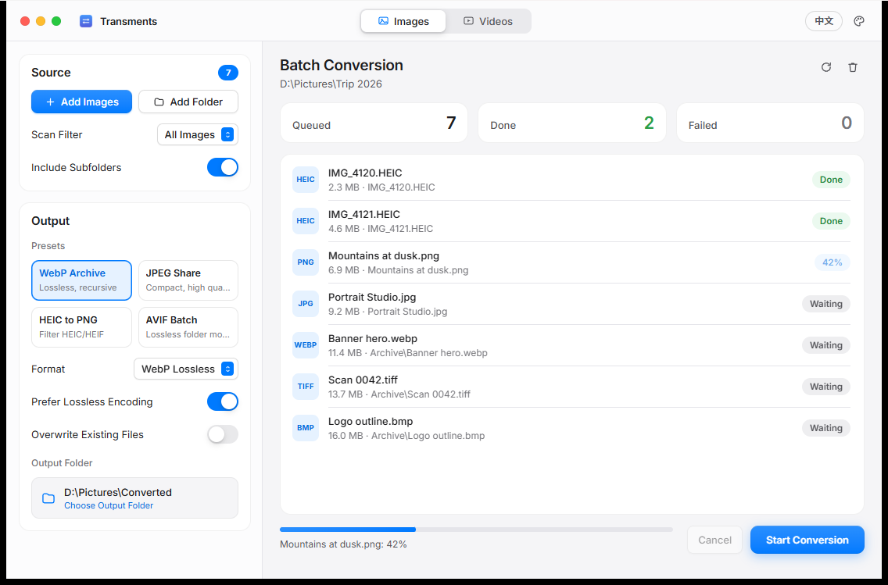
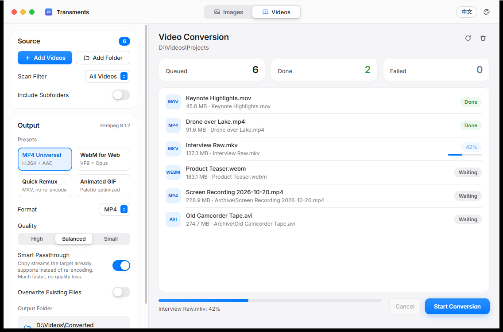

# Transments

> A lightweight image and video format converter built with Rust, with an Apple-style interface.

Transments is a desktop tool for everyday format migration and folder-based batch work. Version 2.0 rewrites the whole project in Rust (Tauri 2): the conversion core is pure Rust, the interface follows macOS design with motion on every interaction, and common video formats can now be converted too.

## Languages

- English: this file
- Chinese: [README.zh-CN.md](README.zh-CN.md)

Switch between English and Chinese from the top-right button; the palette button picks an Apple system accent color.

## Preview




## Features

- **Image and video workspaces**, switched from the title-bar segmented control; each keeps its own queue and settings.
- **Sources**: pick files, scan a folder, or drop files/folders onto the window; filter by input format and include subfolders (relative structure is kept in the output).
- **Presets**: images - WebP Archive, JPEG Share, HEIC to PNG, AVIF Batch; videos - MP4 Universal, WebM for Web, Quick Remux (MKV, no re-encode), Animated GIF.
- **Video options**: three quality levels (High / Balanced / Small) and **Smart Passthrough**, which copies streams the target container already supports instead of re-encoding (MP4 <-> MKV in seconds, no quality loss). Live per-file progress, cancel at any time; partial outputs are removed on cancel.
- **Results panel** with success/failure counts, failed filenames and an Open Output Folder button.
- **Apple-style UI**: macOS traffic lights, sliding segmented controls, iOS switches, popup menus, spring motion, drop highlight; 13 Apple system colors x 4 tones; bundled Inter + Noto Sans SC subsets; honors the system reduce-motion setting.

## Format support

### Images

| Format | Input | Output | Notes |
| --- | --- | --- | --- |
| PNG | Yes | Yes | Lossless |
| JPEG / JPG | Yes | Yes | Quality 100, 4:4:4 |
| WebP | Yes | Yes | Lossless or quality 90; animated GIF/WebP input stays animated |
| TIFF / TIF | Yes | Yes | LZW compression |
| AVIF | Yes | Yes | Lossless (pixel-exact) or quality 80, aom encoder |
| GIF | Yes | Yes | Static output uses the first frame |
| BMP | Yes | Yes | 24-bit |
| HEIC / HEIF | Yes | Yes | libde265 decode, x265 encode (quality 90) |

### Videos (requires FFmpeg)

Input: MP4, M4V, MKV, MOV, WebM, AVI, FLV, WMV, TS / MTS / M2TS, MPG / MPEG, 3GP, OGV, GIF.

| Output | Codecs when re-encoding |
| --- | --- |
| MP4 / M4V / MOV / MKV / FLV / TS | H.264 + AAC |
| WebM | VP9 + Opus |
| AVI | MPEG-4 (XviD) + MP3 |
| WMV | WMV 8 + WMA |
| MPEG | MPEG-2 + MP2 |
| 3GP | H.264 Baseline + AAC |
| GIF | Palette-optimized animation, no audio |
| MP3 | Audio only |

FFmpeg lookup order: `TRANSMENTS_FFMPEG_DIR`, `ffmpeg\bin` or `ffmpeg` next to the exe, the exe folder, then `PATH`. Both `ffmpeg.exe` and `ffprobe.exe` are needed. Without them the video page shows a notice; image conversion is unaffected.

## Tech stack

- **Rust + Tauri 2**: desktop shell, UI rendered by the system WebView2 (single exe, about 26 MB)
- **image / jpeg-encoder / tiff / libwebp**: common image codecs
- **libheif (static, vcpkg)**: HEIC / AVIF with x265, libde265 and aom
- **FFmpeg** (external process): video conversion, `ffprobe` for duration and codecs
- **Vanilla HTML/CSS/JS UI**: no frontend build step

## Project structure

```text
Transments
|-- src
|   |-- main.rs              Tauri shell: commands, dialogs, progress events, drag and drop
|   `-- core                 Conversion core (no UI dependency, testable on its own)
|       |-- mod.rs           Job runner, cancellation, output paths
|       |-- scan.rs          Scanning, filters, dropped-path resolution, natural sort
|       |-- image_conv.rs    Image conversion
|       |-- heif.rs          HEIC / AVIF
|       |-- bmp.rs           BMP writer
|       |-- ffmpeg.rs        Locating / probing ffmpeg
|       `-- video_conv.rs    Video arguments and progress
|-- ui                       index.html, styles.css, app.js, i18n.js, fonts/
|-- tests/converter.rs       Integration tests
|-- scripts                  build.ps1, capture-preview.ps1, grab_window.ps1, verify-i18n.js, make_icon.py
|-- icons, capabilities, tauri.conf.json, Cargo.toml
```

## Building

1. Install Rust (MSVC toolchain) and the Visual Studio 2022 C++ build tools.
2. Install libheif with vcpkg (about 15 minutes the first time):

   ```bash
   vcpkg install "libheif[core,hevc,libde265,aom]:x64-windows-static-md"
   ```

3. Point `VCPKG_ROOT` at your vcpkg checkout (`scripts/build.ps1` defaults to `E:\vcpkg`), then:

   ```bash
   powershell -NoProfile -ExecutionPolicy Bypass -File scripts/build.ps1 -Test
   ```

   Output: `dist/Transments-2.0.0-x64.exe`. Without HEIC/AVIF you can skip vcpkg: `cargo build --release --no-default-features --features custom-protocol`.

Other commands:

```bash
cargo test
```

```bash
node scripts/verify-i18n.js
```

```bash
powershell -NoProfile -ExecutionPolicy Bypass -File scripts/capture-preview.ps1
```

Debug flags: `--lang zh|en`, `--mode image|video`, `--demo` (sample queue for screenshots), `--probe <file>` (measures transition frame rate), `--selftest <dir> --probe <file>` (clicks through the real UI and converts `<dir>\images` and `<dir>\videos`).

## License notes

The UI fonts Inter and Noto Sans SC are SIL OFL 1.1; license files are in `ui/fonts/`. HEIC encoding uses x265 (GPL-2.0) and libheif (LGPL-3.0); keep their obligations in mind when distributing binaries.
