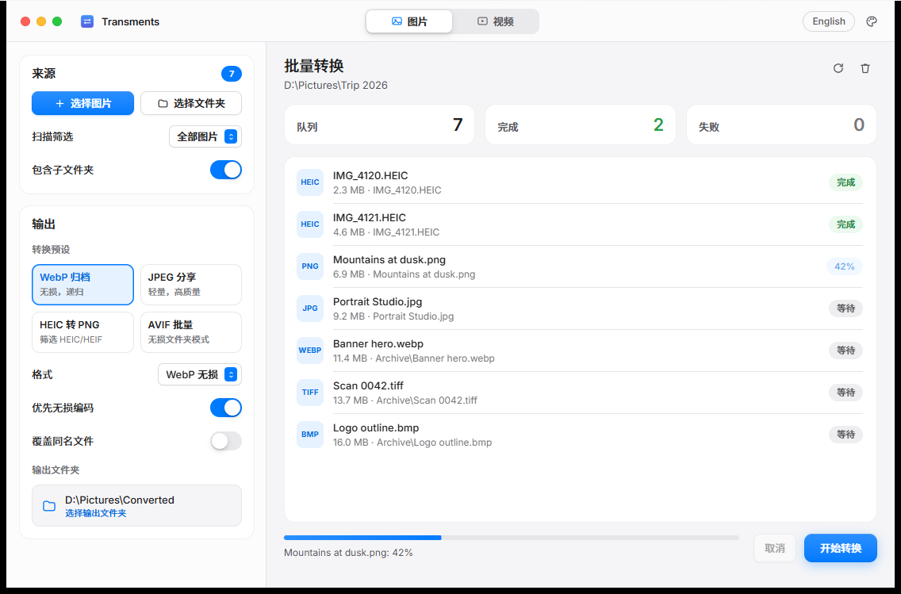
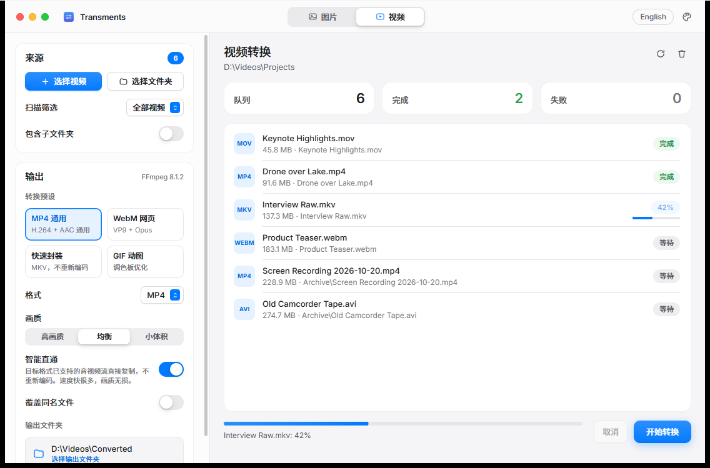
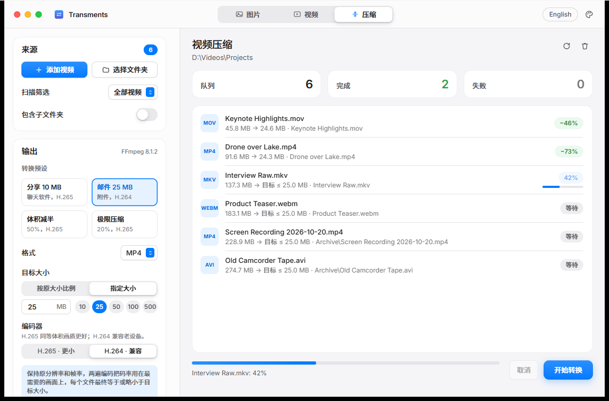

# Transments

> 用 Rust 构建的轻量图片 / 视频格式转换器，Apple 风格界面。

Transments 是一款面向日常格式迁移和文件夹批量处理的桌面工具。2.0 版用 Rust（Tauri 2）重写了整个项目：转换核心全部是 Rust，界面改成 macOS 风格并为所有交互加上动效，同时新增常见视频格式互转。

## 语言

- 中文：当前文件
- 英文：[README.md](README.md)

右上角按钮可在中英文之间切换，调色板按钮可选择 Apple 系统主题色。

## 预览





## 功能

- **图片 / 视频 / 压缩三个工作区**：标题栏分段控件切换，各自保留队列和设置。
- **来源**：选择文件、扫描文件夹、把文件或文件夹拖进窗口；按输入格式筛选，可包含子文件夹（输出保留相对目录结构）。
- **转换预设**：图片：WebP 归档、JPEG 分享、HEIC 转 PNG、AVIF 批量；视频：MP4 通用、WebM 网页、快速封装（MKV 不重新编码）、GIF 动图。
- **视频选项**：三档画质（高画质 / 均衡 / 小体积）；**智能直通**：目标容器已支持的音视频流直接复制，不重新编码（例如 MP4 ↔ MKV 几秒完成、画质无损）。每个文件实时显示进度，可随时取消，取消时删除未完成的输出文件。
- **按指定大小压缩视频**（新）：选择原大小的比例（70/50/30/20%）或直接输入目标 MB，编码器可选 H.265（更小）或 H.264（兼容）。分辨率、帧率和 10 位色深保持不变；两遍编码把码率用在最需要的画面上，结果超出时自动降码率重编码，保证每个文件等于或略小于目标（通常为目标的 96–99%）。已经小于目标的文件直接复制不重新编码；目标小到画面无法保证时会拒绝并提示所需的最小大小。预设：分享 10 MB、邮件 25 MB、体积减半、极限压缩（20%）。在合理大小下画面视觉无损；固定体积必然是有损编码，并非数学意义上的无损。
- **结果面板**：成功 / 失败数量、失败文件名，一键打开输出文件夹。
- **Apple 风格界面**：macOS 红绿灯、分段控件滑块、iOS 开关、弹出菜单、弹簧动效、拖放高亮；13 种 Apple 系统色 × 4 种色调；内置 Inter + 思源黑体子集字体；遵循系统“减少动画”设置。

## 格式支持

### 图片

| 格式 | 输入 | 输出 | 说明 |
| --- | --- | --- | --- |
| PNG | 支持 | 支持 | 无损 |
| JPEG / JPG | 支持 | 支持 | 质量 100，4:4:4 |
| WebP | 支持 | 支持 | 无损或质量 90；动画 GIF/WebP 输入保持动画 |
| TIFF / TIF | 支持 | 支持 | LZW 压缩 |
| AVIF | 支持 | 支持 | 无损（像素完全一致）或质量 80，aom 编码 |
| GIF | 支持 | 支持 | 静态输出取第一帧 |
| BMP | 支持 | 支持 | 24 位 |
| HEIC / HEIF | 支持 | 支持 | libde265 解码，x265 编码（质量 90） |

### 视频（需要 FFmpeg）

输入：MP4、M4V、MKV、MOV、WebM、AVI、FLV、WMV、TS / MTS / M2TS、MPG / MPEG、3GP、OGV、GIF。

| 输出 | 重新编码时使用 |
| --- | --- |
| MP4 / M4V / MOV / MKV / FLV / TS | H.264 + AAC |
| WebM | VP9 + Opus |
| AVI | MPEG-4 (XviD) + MP3 |
| WMV | WMV 8 + WMA |
| MPEG | MPEG-2 + MP2 |
| 3GP | H.264 Baseline + AAC |
| GIF | 调色板优化动图，无声音 |
| MP3 | 仅提取音频 |

### 压缩

输入：FFmpeg 能读取的任意视频。输出：MP4、MKV 或与源相同（MP4 / MKV / MOV / M4V，其他转为 MP4）。音频为 AAC/MP3/AC3 且不超过 192 kbps、预算足够时直接复制，否则重新编码为 48–128 kbps 的 AAC。输出到源文件同一目录时命名为 `<名称>_compressed.<扩展名>`。

FFmpeg 查找顺序：环境变量 `TRANSMENTS_FFMPEG_DIR`、程序目录下的 `ffmpeg\bin` / `ffmpeg`、程序目录、`PATH`。需要同时有 `ffmpeg.exe` 和 `ffprobe.exe`。找不到时视频页和压缩页会提示，图片转换不受影响。

## 技术栈

- **Rust + Tauri 2**：桌面外壳，系统 WebView2 渲染界面（单个 exe，约 26 MB）
- **image / jpeg-encoder / tiff / libwebp**：常见图片编解码
- **libheif（静态链接，vcpkg）**：HEIC / AVIF，内含 x265、libde265、aom
- **FFmpeg**（外部进程）：视频转换，`ffprobe` 读取时长与编码
- **原生 HTML/CSS/JS 界面**：无前端构建流程

## 项目结构

```text
Transments
|-- src
|   |-- main.rs              Tauri 外壳：命令、对话框、进度事件、拖放
|   `-- core                 转换核心（不依赖界面，可单独测试）
|       |-- mod.rs           任务调度、取消、输出路径
|       |-- scan.rs          扫描、筛选、拖放路径解析、自然排序
|       |-- image_conv.rs    图片转换
|       |-- heif.rs          HEIC / AVIF
|       |-- bmp.rs           BMP 写入
|       |-- compress.rs      按目标大小压缩（码率预算、两遍编码、体积校验）
|       |-- ffmpeg.rs        查找 / 探测 ffmpeg
|       `-- video_conv.rs    视频转换参数与进度
|-- ui                       index.html、styles.css、app.js、i18n.js、fonts/
|-- tests/converter.rs       集成测试
|-- scripts                  build.ps1、capture-preview.ps1、grab_window.ps1、verify-i18n.js、make_icon.py
|-- icons, capabilities, tauri.conf.json, Cargo.toml
```

## 构建

1. 安装 Rust（MSVC 工具链）和 Visual Studio 2022 C++ 生成工具。
2. 用 vcpkg 安装 libheif（首次约 15 分钟）：

   ```bash
   vcpkg install "libheif[core,hevc,libde265,aom]:x64-windows-static-md"
   ```

3. 设置 `VCPKG_ROOT` 指向 vcpkg 目录（`scripts/build.ps1` 默认 `E:\vcpkg`），然后：

   ```bash
   powershell -NoProfile -ExecutionPolicy Bypass -File scripts/build.ps1 -Test
   ```

   产物：`dist/Transments-2.0.0-x64.exe`。不需要 HEIC/AVIF 时可以 `cargo build --release --no-default-features --features custom-protocol`，不依赖 vcpkg。

其他命令：

```bash
cargo test
```

```bash
node scripts/verify-i18n.js
```

```bash
powershell -NoProfile -ExecutionPolicy Bypass -File scripts/capture-preview.ps1
```

调试参数：`--lang zh|en`、`--mode image|video|compress`、`--demo`（示例队列，用于截图）、`--probe <文件>`（测量切页帧率）、`--selftest <目录> --probe <文件>`（在真实界面里自动点击并转换 `<目录>\images`、`<目录>\videos`）。

## 许可

界面字体 Inter 与思源黑体（Noto Sans SC）均为 SIL OFL 1.1，许可文件见 `ui/fonts/`。HEIC 编码使用的 x265 为 GPL-2.0，libheif 为 LGPL-3.0，分发二进制时请注意相应义务。
